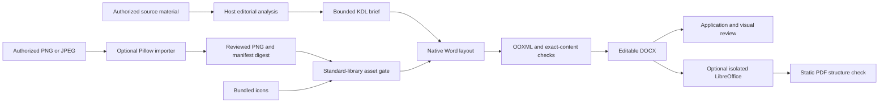

# KMDStudio project status

27 November 2026, Europe/Moscow

## Executive summary

KMDStudio is an original Agent Skill for professional, visually expressive, editable documents. Its deterministic core generates A4 DOCX from a bounded brief with native Word headings, lists, tables, annotated code, diagrams, and figures. The 0.3.0rc1 candidate adds approved local and host-generated illustrations while keeping the DOCX core free of third-party dependencies.

The candidate is usable for local DOCX production in the tested workflow. Six CLI benchmarks pass, all three new files open in Word, and hosted Windows and Ubuntu verification passes. The reviewed source, synthetic examples, and candidate package are public for review. Stable distribution awaits an owner-approved redistribution license, additional acceptance evidence, and an independent security review. Qualified PDF delivery, screen-reader behavior, and a measured advantage over ordinary agent behavior remain open.

## Development history

| Milestone | Delivered capability and evidence | Open items |
| --- | --- | --- |
| 0.1.0 | First portable skill, bounded brief, editable DOCX, exact text and native structures, local security checks, two worked examples, and initial PDF structure tests. Seventeen tests were recorded with the optional parser. [Verification](VERIFICATION-v0.1.0.md) | Agent runs lacked completed turns. Word application and accessibility checks were pending. |
| 0.2.0 | Six KDL profiles, semantic tokens, expanded native composition, three benchmark sets, and tighter DOCX and PDF validation. Corrected the table layout attribute from `w:val` to `w:type` and a Writer shaded-panel rendering defect. All 25 tests passed in the project environment. [Verification](VERIFICATION.md) | General raster import was absent. Matched agent runs timed out, and network-restricted PDF delivery remained unqualified. |
| 0.3.0rc1 | A real ImageGen illustration goes through the bounded import and review path to Word. Wider figures and alignment support reading-scale imagery. Three new benchmarks exercise a gallery workflow, a dense ledger, and long code. Word and SDK validation and hosted CI provide additional acceptance evidence. [Verification](VERIFICATION-v0.3.0rc1.md) | Independent human design review, screen-reader behavior, comparative agent scores, and qualified PDF delivery. |

The root Git repository began with the actual 0.2.0 snapshot. Earlier versions remain historical records and artifacts. Existing KDL profiles, native structures, content-preservation rules, and PDF validation were reused. The current milestone adds a document capability the previous skill could not deliver. [Baseline commit](https://github.com/apollogens/KMDStudio/commit/899e36069049ca6e43f1b59b975914ba8ce4ed9a) and [draft review](https://github.com/apollogens/KMDStudio/pull/1)

## Architecture

The host owns source permissions, editorial choices, external model and image transfers, and target review. The brief contains content, roles, and approved asset IDs. `guard.py` confines operator-selected paths, verifies identity while reading, and publishes through an exclusive link from a flushed stage. `spec.py` validates the shape and `design.py` resolves semantic typography, color, density, and composition. `layout.py` and `ooxml.py` build Word parts. `review_docx.py` reads the result and checks content, metadata, and package structure before publication.

Native image decoding and PDF rendering sit outside the core. `import_raster.py` normalizes bytes. `raster.py` validates the pinned manifest, hashes, and PNG scanlines before layout. The optional PDF path adds LibreOffice and pypdf and relies on separately established OS isolation. Bounded output profiles support predictable verification, at the cost of arbitrary document ingestion and complex layouts. [Architecture](ARCHITECTURE.md) and [security model](threatmodel.md)

## Global capability matrix

Previous status refers to the observed 0.2.0 baseline. Current status refers to the candidate and the evidence cited below. PASS applies to the demonstrated scope of each row.

| ID and capability | Implementation | Previous | Observed evidence | Current | Remaining gap |
| --- | --- | --- | --- | --- | --- |
| ACT-01 Skill activation | `SKILL.md`, `agents/openai.yaml`, `evals/` | NOT RUN | Frontmatter and packaged discovery resources pass validation. Tool smoke completed a turn without reading its fixture. | NOT RUN | Explicit, implicit and negative activation in a completed controlled session. |
| CNT-01 Content analysis | `SKILL.md`, `references/quality.md`, schema | PARTIAL | Host workflow covers intake and required facts. Six generated briefs preserve required IDs. | PARTIAL | Measure autonomous extraction and analysis on varied source material. |
| DIR-01 Autonomous art direction | `references/design.md`, `references/illustrations.md` | PARTIAL | Host produced three intentional layouts and a gallery art brief. | PARTIAL | Independent matched agent and human design evaluation. |
| REF-01 Reference interpretation | `SKILL.md`, `evals/cases.json` | PARTIAL | Reference workflow and a synthetic case exist. | PARTIAL | Score reference fidelity and originality in completed runs. |
| TYP-01 Typography | `design.py`, `layout.py` | PASS | Profile and override tests pass. Word and Writer handle the candidate listing and styled document samples. | PASS | Wider font and locale coverage. |
| CLR-01 Color system | `design.py` | PASS | Semantic contrast checks pass. Reviewed previews show role distinctions. | PASS | App-specific canvas color and print behavior. |
| LAY-01 Composition | `layout.py`, brief schema | PASS | One-page gallery at 146 mm figure width. Listing and exercise fit in two pages after KDL tuning. | PASS | Multi-column and anchored placement are outside current scope. |
| CMP-01 Reusable components | `layout.py`, `spec.py`, schema | PASS | Ten block types share native functions. Ledger, list, diagram, and figure evidence pass. | PASS | More complex structures require separate acceptance cases. |
| ART-01 Image generation integration | `references/illustrations.md`, gallery fixture | NOT IMPLEMENTED | Actual host-generated original passes import and appears in the verified gallery file. | PASS | Availability and rights depend on host and source. Measure autonomous selection. |
| ART-02 Safe image import | `import_raster.py`, `raster.py` | NOT IMPLEMENTED | Optional static PNG and JPEG decoder. Hash-pinned receipt, asset, and bounded normalized streams are checked. | PASS | Independent review of decoder isolation. Color-managed inputs require separate evidence. |
| ICO-01 Icon library | `assets/manifest.json`, `tools/build_icons.py` | PASS | Two verified Lucide derivatives with pinned notices. | PASS | Library remains intentionally small. |
| DIA-01 Technical diagrams | `layout.py` diagram and table blocks | PARTIAL | The exact three-step search trace stays editable. | PARTIAL | Branching graphs, equations, and richer diagrams. |
| DOC-01 Editable DOCX | `generate.py`, `layout.py`, `review_docx.py` | PASS | Six generators pass, SDK reports zero errors, and three candidate documents open in Word. | PASS | Extend app and platform compatibility evidence beyond the tested samples. |
| PDF-01 PDF rendering | `render_pdf.py`, optional pypdf lock | PARTIAL | All parser tests pass. Renderer descendant network denial has not been demonstrated. | PARTIAL | Qualified delivery is BLOCKED pending an appropriate sandbox. |
| PPT-01 PPTX | None | NOT IMPLEMENTED | No presentation generator. | NOT IMPLEMENTED | Deferred beyond the DOCX milestones. |
| TXT-01 Content preservation | `spec.py`, `review_docx.py`, independent verifier | PASS | Required IDs and exact code survive. All 32 dispatch rows, 1,725 planned and 1,699 actual remain native. | PASS | Measure fidelity at host source extraction as well as after brief creation. |
| SEC-01 Output security | `guard.py`, `review_docx.py`, `raster.py` | PASS | Path, package, XML, hash, and image mutation tests pass. Publication stays exclusive. | PASS | Independent security review and OS containment remain separate prerequisites. |
| VIS-01 Visual review | Benchmark PNGs and application checks | PASS | Five final Writer pages examined and compared where applicable. | PASS | Independent preference scores and Word visual coverage. |
| ACC-01 Accessibility | Word styles, table headers and image descriptions | PARTIAL | Open XML and Word confirm native structures and exact gallery alt text. | PARTIAL | Keyboard navigation, screen readers, and PDF/UA. |
| EVA-01 Agent evaluation | `evals/run.py`, `evals/cases.json` | NOT RUN | Provider ran a bounded local-tool smoke, but did not read the input. | NOT RUN | Standalone shell-enabled host and completed A/B/C comparison. |
| PLT-01 Platform compatibility | CLI, test suite and hosted matrix | PARTIAL | Windows and Ubuntu pass on Python 3.11 and 3.15. | PASS | Word application evidence is Windows-specific. Other OS and architectures are unverified. |
| PKG-01 Portable skill | `skills/kmdstudio`, `tools/verify_bundle.py` | PASS | 25 exact members, CRCs, fresh extraction and site-disabled usage. | PASS | Signing and distribution channel review. |
| CI-01 GitHub Actions | `.github/workflows/verify.yml`, `requirements/ci.lock` | NOT IMPLEMENTED | Four hosted jobs pass with pinned action commits and wheels. | PASS | Keep the matrix and pins current. [Verified run](https://github.com/apollogens/KMDStudio/actions/runs/46044305859) |
| PUB-01 Public distribution | Git and public draft PR | NOT IMPLEMENTED | Baseline and development branch published. Draft PR with reviewed files is open. | PARTIAL | Stable release, license decision and independent review. [Draft PR](https://github.com/apollogens/KMDStudio/pull/1) |

## Technical metrics

| Metric | Observed value |
| --- | --- |
| Skill source | 88,648 bytes of Python. `SKILL.md` uses 1,854 bytes. |
| Bundle | 25 files, 123,291 expanded bytes and 45,467 archived bytes. |
| Runtime and options | Zero third-party DOCX dependencies on Python 3.11+. Pillow 13.0.0 is optional for import and pypdf 7.2.0 is optional for the LibreOffice export path. |
| Local tests | 25 pass and 5 optional skips with system Python. All 30 pass with extras installed. Zero failures in both final local runs. |
| Coverage | No line-coverage instrument was used. The verification record lists directly exercised capabilities. |
| Benchmarks | 6 of 6 generated and inspected structurally from the candidate archive. The three old benchmarks match all OOXML parts from the old generator on each test interpreter. |
| Generation time | One local Windows CPython 3.15.2 pass took 160–247 ms per CLI invocation, including startup, package verification, and disk write. This is a single-run measurement. |
| Candidate DOCX size | 5,523 bytes for the algorithms guide, 5,236 bytes for the ledger and 669,922 bytes for the gallery. |
| Independent validation | Open XML SDK 2.9.1 reports 0 errors across 6 delivered and regression documents. The Word check opened all 3 candidate files and reported 5 pages in total. |
| Agent token usage | One 37.78-second smoke used 313,651 input tokens with 282,624 cached and 1,051 output tokens with 432 reasoning tokens. The model did not read the input. |
| Hosted CI | 4 of 4 jobs pass on Windows and Ubuntu with CPython 3.11 and 3.15. [Verified workflow](https://github.com/apollogens/KMDStudio/actions/runs/46044305859) |

## Security report

Implemented controls include bounded JSON, ZIP, XML, and normalized PNG parsing, exact package allowlisting, no external relationships or executable attachments, explicit approved paths, and no-replacement output publication. For illustrations, the importer strips auxiliary metadata. The core pins reviewed manifest and asset bytes, and slot verification checks image geometry, alt text, and caption placement. The renderer has separate static PDF controls and host prerequisites. The test suite mutates synthetic outputs and metadata to exercise rejection. [Security policy](../SECURITY.md), [tests](../tests), and [threat model](threatmodel.md)

Confirmed defects were scoped to interoperability, packaging, representative layout, and verification. The prior `w:tblLayout` attribute caused actual SDK errors and was corrected in 0.2.0. This iteration caught the trailing exercise-only page, a CI YAML parse error, an archive line-ending mismatch, and a Windows test path issue. Corrections preserved source content and existing raw-path restrictions. The current iteration does not claim a verified exploitable vulnerability.

Residual risks include races in shared writable directories, decoder and renderer faults, malicious or sensitive pixels, untrusted source instructions handled by the agent, and compromised trusted manifests or supply-chain inputs. Decoder and renderer isolation are operator responsibilities. Published content is project code, synthetic fixtures and examples, and verification evidence. Dependency hashes and asset sources are documented. Raw traces, private source files, environments and diagnostics stay local. [Third-party notices](../THIRD_PARTY_NOTICES.md)

## Product quality

The previous skill could render the gallery text but could not place the approved original image. The candidate provides a one-page study with readable clay ridges and shadow, a caption and two editable observation prompts. The algorithms guide exposes one long wrapped line but fits the whole exercise with the listing after changing KDL spacing. The ledger keeps its decision above two pages of exact batch data, with native rows and header definitions. These observations describe the inspected documents and applications. [Candidate DOCX files and previews](../artifacts/v0.3.0rc1) and [A/B review](../artifacts/v0.3.0rc1/review)

External SDK validation and actual Word opening and repagination independently check document behavior. The implementation pass supplied the visual observations. Human preference scores and a matched comparison with ordinary agents remain pending. [Verification record](VERIFICATION-v0.3.0rc1.md)

## Roadmap and release gate

The next high-value milestone is one matched standalone agent evaluation with a working local tool smoke, three equivalent configurations, and blinded human review. Measure source fidelity, useful layout choices, safe tool behavior, time, and corrections. Extend to the positive and negative activation suite after that comparison succeeds.

Word accessibility work should exercise keyboard navigation, repeated headers, list and heading reading order, and meaningful alternatives for figures. Qualified PDF is a separate optional milestone on a host which demonstrates the required isolation. Defer PPTX, richer diagrams, and additional profiles until a benchmark or user workflow establishes their need.

A stable release requires mandatory CI, qualified claims for each supported path, accessibility and independent security review for the published scope, and owner approval of the project license. [Roadmap](ROADMAP.md)
